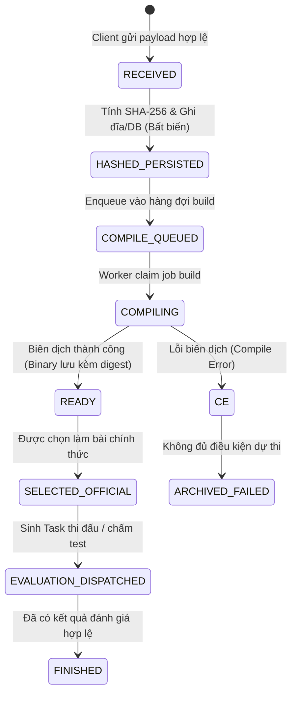
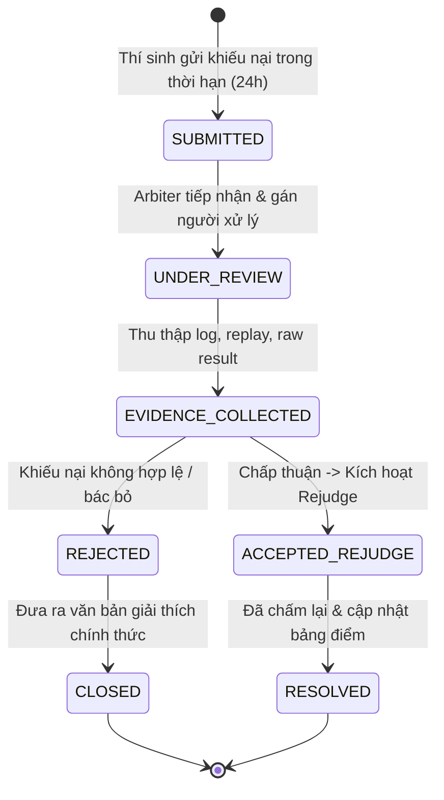

# Hồ sơ thiết kế chi tiết phần Phát — A01–A08
**Chủ trì:** Phát (Người 1) • **Vai trò:** Nghiệp vụ, Lõi API Generic v2, Adapter Contract, Thể thức thi đấu & Scoring  
**Học phần:** INT3304 (Lập trình mạng) • **Dự án:** how-i-organize-a-contest  
**Ngày lập:** 19/10/2026 • **Múi giờ:** UTC+7 • **Trạng thái:** Tài liệu thiết kế chi tiết & Đặc tả kỹ thuật nghiệm thu

---

## 16.1. Đầu ra và ranh giới bàn giao

Phát giữ vai trò **Người 1** trong nhóm 3 người, chịu trách nhiệm pháp lý và kỹ thuật cao nhất về tính đúng đắn của luật chơi, tính công bằng của mùa giải, tính bất biến của cấu hình/điểm số, cùng kiến trúc generic mở rộng của nền tảng (không hardcode engine OTT vào lõi hệ thống).

### Ranh giới trách nhiệm & phân công phối hợp:
1. **Với Toàn (Người 2 - Worker, Sandbox, Hạ tầng & Vận hành):**
   - *Phát bàn giao:* Đặc tả hợp đồng `JobSpec`, `RawResult`, schema `SeasonSnapshot`, mã lỗi tiêu chuẩn (`reason_code`), yêu cầu cách ly dữ liệu test/placement kín, chính sách retry khi lỗi hạ tầng (`INFRA_ERROR` không xử thua bài nộp), và tiêu chí nghiệm thu đánh giá lại (`RejudgeRevision`).
   - *Toàn bàn giao cho Phát:* Cơ chế bảo đảm tính lặp an toàn (`lease_epoch`, `fencing token`), state machine nhận việc `claim_job()`, runtime capability, giới hạn tài nguyên sandbox (CPU, RAM, PID, no-network, timeout), và biên bản đối soát dữ liệu cutover SQLite $\to$ PostgreSQL.
   - *Quy tắc phối hợp:* Mọi sửa đổi trạng thái thực thi do Toàn đề xuất phải ánh xạ chính xác vào miền trạng thái nghiệp vụ do Phát phê duyệt. Không tự suy diễn lỗi container thành lỗi bài nộp nếu chưa có bằng chứng verdict từ adapter.

2. **Với Minh (Người 3 - Frontend, BFF, QA & Trải nghiệm BTC/Thí sinh):**
   - *Phát bàn giao:* Đặc tả OpenAPI 3.1 của Core API `/api/v2` (bao gồm `Season`, `Entry`, `Submission`, `Standings`, `Appeals`), quy tắc lọc dữ liệu nhạy cảm theo vai trò (`PublicView`), cơ chế CSRF/SameSite cookie, và quy chuẩn hiển thị bảng điểm có `standings_revision`.
   - *Minh bàn giao cho Phát:* Kịch bản kiểm thử E2E người dùng, giao diện cấu hình mùa giải (`Wizard C01`), phản hồi về trải nghiệm nộp bài/xem replay an toàn, và kết quả diễn tập các tình huống tranh chấp/khiếu nại.
   - *Quy tắc phối hợp:* Không bao giờ trả về frontend dữ liệu placement bí mật của đối thủ hoặc test-case kín rồi nhờ browser ẩn đi. Toàn bộ việc ẩn dữ liệu phải thực thi nghiêm ngặt tại Core API của Phát.

### Bảng tóm tắt đầu ra công việc của Phát (A01 – A08):
| Mã | Hạng mục | Đầu ra cụ thể | Tiêu chí nghiệm thu cốt lõi |
|---|---|---|---|
| **A01** | Scope và RBAC | Ma trận RBAC đa vai trò, đa mùa; Engine kiểm tra quyền & Scope | Chặn đứng 100% IDOR; tài khoản thí sinh không xem được source/test kín đối thủ; dual-approval cho thay đổi trọng yếu. |
| **A02** | Snapshot & Validation | JSON Schema của `CompetitionDefinition` và `SeasonSnapshot`; Validator engine | Bất biến sau công bố; từ chối mọi tổ hợp sai (quota mâu thuẫn, clock âm, tie-break thiếu); sửa đổi sinh revision mới. |
| **A03** | Core API Generic v2 | OpenAPI 3.1 spec `/api/v2`; Core domain models & API controller | Không hardcode OTT; timestamp nhận bài bất biến tính từ lúc server nhận đủ payload hợp lệ; chính sách chọn bài chính thức rõ ràng. |
| **A04** | Thể thức & Scoring | Strategy pattern cho Thể thức (Round-robin, Single Elimination, Task Queue) & Scorer (Weighted Sum, Match Points, Metric) | Tái tính toán (recalculate) trên cùng raw result luôn cho cùng bảng điểm (Idempotent & Deterministic); đa cấp tie-break không mơ hồ. |
| **A05** | Adapter Contract | Giao diện chuẩn `EvaluationAdapterInterface`, Registry trung tâm, Test Conformance suite | Chuẩn hóa dữ liệu I/O giữa Core và Engine; từ chối plugin không hợp lệ ngay tại bước tiền kiểm tra; bảo vệ bí mật game. |
| **A06** | Adapter Bộ Test | `TestSuiteAdapter` tích hợp trực tiếp engine judge C++17 hiện có | Chấm bài qua pipeline test-suite; xuất verdict AC/WA/TLE/RE/CE chuẩn; test case bí mật không bao giờ mount vào container thí sinh. |
| **A07** | Audit, Chấm lại & Khiếu nại | Mô hình Audit Log append-only; Rejudge Coordinator có revision; Appeal State Machine | Mọi điều chỉnh điểm/rejudge đều giữ lịch sử và cần 2 người duyệt; quy trình khiếu nại minh bạch với SLA và retention rõ ràng. |
| **A08** | Hai mùa giải mẫu | Bộ fixture `season_1_test_suite.json` và `season_2_bot_arena.json`; Script đối soát E2E | Cùng một lõi Core chạy mượt mà cả giải Chấm bài Tin học và giải Đấu bot đối kháng OTT Arena; chứng minh tính tái sử dụng 100%. |

---

## 16.2. A01 — Phạm vi quyền (Scope) và Ma trận RBAC đa người dùng / đa mùa giải

### 16.2.1. Thiết kế vai trò (Roles) và Không gian quyền (Scopes)
Hệ thống quản lý giải đấu phân chia ranh giới theo mô hình kết hợp: **Global Role** (vai trò toàn hệ thống) và **Season Role** (vai trò gán theo từng mùa giải cụ thể). Điều này ngăn chặn việc một Organizer của Mùa giải A có thể can thiệp dữ liệu của Mùa giải B.

Các vai trò tiêu chuẩn:
1. **SYSTEM_OPERATOR (Vận hành hệ thống):** Cài đặt runtime, đăng ký Adapter vào hệ thống, quản lý tài nguyên host/worker, khôi phục thảm họa. Thuộc vùng tin cậy hạ tầng; không can thiệp sửa kết quả thi đấu nếu không có biên bản sự cố.
2. **ORGANIZER (Ban tổ chức mùa giải):** Khởi tạo mùa giải, cấu hình `SeasonSnapshot`, mời thí sinh, thiết lập deadline, công bố kết quả. Quyền hạn bị giới hạn nghiêm ngặt theo `season_id`.
3. **ARBITER / PROBLEM_SETTER (Trọng tài / Ban ra đề):** Quản lý bộ test, kiểm định tính hợp lệ của game adapter, giải quyết khiếu nại, đề xuất chấm lại.
4. **AUDITOR (Kiểm tra độc lập):** Quyền chỉ đọc (read-only) đối với toàn bộ audit log, lịch sử cấu hình, diff revision và raw result. Không có quyền sửa đổi bất kỳ dữ liệu nào.
5. **CONTESTANT (Thí sinh):** Đăng ký tham gia giải, tạo đội, nộp bài/bot, xem lịch thi đấu của mình, xem kết quả và nộp khiếu nại.
6. **SPECTATOR (Khán giả):** Xem thông tin giải đấu công khai, bảng xếp hạng công bố, và các bản replay trận đấu đã được làm sạch dữ liệu bí mật.

### 16.2.2. Ma trận phân quyền (RBAC Matrix)

| Hành vi nghiệp vụ / Tài nguyên | OPERATOR | ORGANIZER (mùa đó) | ARBITER (mùa đó) | CONTESTANT (đội mình) | SPECTATOR | AUDITOR |
|---|:---:|:---:|:---:|:---:|:---:|:---:|
| Đăng ký Runtime / Adapter mới | **CRUD** | R | R | - | - | R |
| Tạo / Soạn thảo Season Draft | - | **CRUD** | R | - | - | R |
| Khóa & Công bố Season Snapshot | - | **Xác nhận 1** | **Xác nhận 2** | - | - | R |
| Đăng ký suất thi đấu (Entry) | - | Duyệt / Mời | - | **Tạo / Rút** | - | R |
| Nộp bài thi (Source code) | - | - | - | **Tạo (bản mình)** | - | R |
| Đọc source code bài thi | - | Theo quy chế | Khi khiếu nại | **Chỉ bản của mình** | - | R (audit) |
| Xem Test case / Placement bí mật | - | - | R (đề của mình) | **Chỉ của mình (trước reveal)** | - | - |
| Trigger Job đánh giá / thi đấu | Tự động | Trigger lịch | - | Nộp bài auto-queue | - | - |
| Xem Raw Evaluation Result / Logs | R | R | R | Bản filtered của mình | - | R |
| Xem Replay trận đấu | R | R | R | Replay an toàn | Replay an toàn | R |
| Xem Bảng xếp hạng (Standings) | R | R | R (toàn bộ) | Theo visibility mùa | Công bố | R |
| Đề xuất Chấm lại (Rejudge Request) | - | **Đề xuất** | **Đề xuất** | Khiếu nại | - | R |
| Phê duyệt Chấm lại (Rejudge Approval)| - | **Duyệt 1** | **Duyệt 2** | - | - | R |
| Xem Audit Log append-only | R | R (mùa mình) | R (mùa mình) | - | - | **R (đầy đủ)** |

### 16.2.3. Quy tắc phòng chống IDOR và Bảo mật dữ liệu bí mật
- **Nguyên tắc định danh kép:** Mọi request can thiệp tài nguyên bài nộp hoặc trận đấu phải kiểm tra `(season_id, resource_id, authenticated_user_id)`. Không truy vấn DB thuần túy bằng `WHERE id = :id`.
- **Chống lộ vị trí Placement (Game OTT):** Trong suốt giai đoạn đặt quân (`phase == PLACEMENT`), observation gửi cho Bot hoặc trả về API cho thí sinh chỉ chứa tọa độ quân của chính thí sinh đó. Toàn bộ quân của đối thủ bị che thành `UNKNOWN` hoặc ẩn hoàn toàn. API người xem và Organizer tuyệt đối không trả mảng placement đầy đủ cho đến khi phase chuyển sang `PLAY`.
- **Chống lộ Bộ Test kín (Test-suite Problem):** Thí sinh chỉ nhận được input/output của các test case mẫu (`is_sample: true`). Các test case chính thức chấm điểm chỉ trả về: Mã test ID (ẩn danh), trạng thái verdict (`AC`, `WA`, `TLE`, `RE`), thời gian CPU, bộ nhớ tiêu thụ, và điểm số. Tuyệt đối không trả về file input/output thật của test kín.
- **Nguyên tắc Dual-Approval (Hai người duyệt):** Mọi hành động làm thay đổi kết quả thi đấu đã công bố (chỉnh sửa luật giữa chừng, cập nhật test case, rejudge hàng loạt) bắt buộc phải do 2 tài khoản có vai trò khác nhau ký duyệt (ví dụ: Organizer tạo lệnh $\to$ Arbiter duyệt, hoặc ngược lại).

---

## 16.3. A02 — CompetitionDefinition, SeasonSnapshot và Cơ chế Schema Validation

### 16.3.1. Hợp đồng định nghĩa cuộc thi (CompetitionDefinition)
`CompetitionDefinition` đóng vai trò là "Khuôn mẫu" (Blueprint/Catalog) xác định một thể loại cuộc thi:
- `definition_id`: Định danh duy nhất (ví dụ: `classic-c-cpp-algo`, `ott-turn-based-arena`).
- `version`: Phiên bản định nghĩa (Semantic Versioning: `1.0.0`).
- `category`: `TEST_SUITE_PROBLEM` hoặc `INTERACTIVE_BOT_MATCH`.
- `supported_adapters`: Danh sách Adapter ID và dải phiên bản tương thích.
- `supported_runtimes`: Danh sách Runtime Profile hợp lệ (ví dụ: `cpp17-gcc13-linux`, `python311-slim`).
- `config_schema`: JSON Schema dùng để kiểm tra tính hợp lệ của cấu hình mùa giải khi khởi tạo.

### 16.3.2. Ảnh chụp cấu hình mùa giải bất biến (SeasonSnapshot)
Khi Organizer hoàn thành việc soạn thảo cấu hình và chuyển mùa giải sang trạng thái `REGISTRATION_OPEN` hoặc `LOCKED`, toàn bộ cấu hình sẽ được "đóng băng" thành một `SeasonSnapshot` bất biến.
Mỗi snapshot được băm (`SHA-256`) trên chuỗi JSON chuẩn hóa (Canonical JSON: sắp xếp khóa theo bảng chữ cái alphabet, mã hóa UTF-8 không khoảng trắng thừa).

Cấu trúc cốt lõi của `SeasonSnapshot`:
```json
{
  "$schema": "https://schemas.contest.uet.vnu.edu.vn/v2/season_snapshot.json",
  "season_id": "season-2026-fall-ott-cup",
  "revision": 1,
  "snapshot_hash": "e3b0c44298fc1c149afbf4c8996fb92427ae41e4649b934ca495991b7852b855",
  "competition_definition_id": "ott-turn-based-arena",
  "competition_version": "1.0.0",
  "adapter_binding": {
    "adapter_id": "ott-engine-adapter",
    "adapter_version": "1.0.0"
  },
  "runtime_profile": {
    "profile_id": "cpp17-standard-bot",
    "image_digest": "sha256:1a2b3c4d5e6f7a8b9c0d1e2f3a4b5c6d7e8f9a0b1c2d3e4f5a6b7c8d9e0f1a2b",
    "compile_timeout_sec": 15,
    "compile_cpu_limit": 1.0,
    "compile_memory_limit_mb": 1024,
    "runtime_cpu_limit": 1.0,
    "runtime_memory_limit_mb": 256,
    "runtime_pids_limit": 64,
    "network_mode": "none"
  },
  "tournament_format": {
    "format_type": "DOUBLE_ROUND_ROBIN",
    "parameters": {
      "swap_sides": true,
      "bye_handling": "NO_POINTS"
    }
  },
  "scoring_policy": {
    "policy_type": "BOT_MATCH_POINTS",
    "parameters": {
      "points_win": 3,
      "points_draw": 1,
      "points_loss": 0,
      "tie_breakers": ["HEAD_TO_HEAD", "SCORE_DIFFERENCE", "REGISTRATION_TIME"]
    }
  },
  "official_submission_policy": "LAST_VALID_BEFORE_DEADLINE",
  "limits_and_quotas": {
    "max_teams": 30,
    "max_members_per_team": 3,
    "max_source_size_bytes": 262144,
    "max_compiles_per_team": 10,
    "submission_window": {
      "opens_at": 1760832000,
      "closes_at": 1760875200
    }
  },
  "dispute_and_retention": {
    "protest_window_seconds": 86400,
    "artifact_retention_days": 90
  }
}
```

### 16.3.3. Các quy tắc Schema Validation bắt buộc
Validator độc lập của Phát kiểm tra và chặn đứng các lỗi cấu hình sau:
1. **Chặn thời gian mâu thuẫn:** `submission_window.closes_at` phải lớn hơn `opens_at`. Nếu mùa giải có thi đấu theo ca, `tournament_start_time >= closes_at`.
2. **Chặn mâu thuẫn tài nguyên:** Giới hạn RAM biên dịch $\ge$ RAM runtime; Giới hạn thời gian timeout $> 0$; Concurrency quota không được vượt quá năng lực đăng ký của worker pool.
3. **Chặn liên kết Adapter/Runtime không tương thích:** Runtime profile phải nằm trong danh mục `supported_runtimes` của `CompetitionDefinition`.
4. **Chặn Tie-breaker mơ hồ:** Danh sách tiêu chí phân hạng phụ (`tie_breakers`) bắt buộc phải kết thúc bằng một tiêu chí tất định (ví dụ: `REGISTRATION_TIME` hoặc `ENTRY_ID`) để không bao giờ xảy ra tình trạng thứ hạng không xác định khi xuất biên bản.

---

## 16.4. A03 — Core API Generic v2 và Vòng đời bài nộp bất biến

### 16.4.1. Cấu trúc Endpoint `/api/v2` chuẩn hóa
Khác với `/api/v1` bị gắn chặt vào OTT, `/api/v2` do Phát thiết kế là API hướng tài nguyên generic:
- `GET /api/v2/competitions`: Danh mục các thể loại cuộc thi có sẵn.
- `GET /api/v2/seasons`: Danh sách các mùa giải (lọc theo trạng thái, người tạo).
- `POST /api/v2/seasons`: Tạo mùa giải mới (yêu cầu vai trò ORGANIZER).
- `GET /api/v2/seasons/{season_id}/snapshot`: Lấy cấu hình SeasonSnapshot hiện hành.
- `POST /api/v2/seasons/{season_id}/entries`: Thí sinh đăng ký suất thi đấu.
- `POST /api/v2/seasons/{season_id}/submissions`: Thí sinh nộp source code (Payload: `source` dạng string hoặc multipart, metadata ngôn ngữ).
- `GET /api/v2/seasons/{season_id}/submissions`: Xem lịch sử bài nộp của đội mình (Organizer xem danh sách mã hash/trạng thái compile).
- `GET /api/v2/seasons/{season_id}/standings`: Xem bảng xếp hạng giải đấu (trả về kèm theo `standings_revision` và `last_updated_at`).
- `POST /api/v2/seasons/{season_id}/appeals`: Thí sinh gửi đơn khiếu nại kết quả.
- `POST /api/v2/seasons/{season_id}/rejudge`: Ban tổ chức yêu cầu chấm lại (Dual-approval workflow).

### 16.4.2. Vòng đời nộp bài và Tính bất biến của Submission


**Nguyên tắc cốt lõi về thời điểm nộp bài:**
- **Server Receipt Timestamp:** Thời điểm nộp bài được chốt tại khoảnh khắc Server nhận **đầy đủ byte cuối cùng của HTTP payload hợp lệ**, kiểm tra kích thước không vượt quá `max_source_size_bytes` (256 KiB) và ghi nhận timestamp của hệ thống đồng hồ server UTC+7.
- **Không trừng phạt thí sinh vì hàng đợi:** Nếu thí sinh nộp trước deadline 30 giây, nhưng hệ thống compiler worker bị nghẽn khiến 5 phút sau bài mới compile xong, bài nộp **vẫn được công nhận hợp lệ** vì `received_at <= deadline`.
- **Chính sách bài chính thức (`OfficialSubmissionPolicy`):**
  1. `LAST_VALID_BEFORE_DEADLINE`: Tự động lấy bài nộp cuối cùng có `compile_status == 'READY'` trước thời điểm đóng hạn.
  2. `BEST_SCORE`: Dành cho giải chấm điểm test-suite, tự động lấy bài nộp có tổng điểm cao nhất.
  3. `MANUAL_LOCK`: Thí sinh chủ động bấm chọn bản nộp mong muốn trên giao diện trước khi giải khóa sổ.

---

## 16.5. A04 — Phân tách Thể thức (Format) và Chính sách Chấm điểm (Scoring Policy)

### 16.5.1. Strategy Pattern cho Thể thức thi đấu (Tournament Formats)
Lõi hệ thống định nghĩa interface `FormatStrategy`:
$$\text{generate\_pairings}([\text{entries}], \text{params}) \to [\text{EvaluationTaskSpec}]$$

1. **Double Round-Robin (Vòng tròn 2 lượt):**
   - Áp dụng thuật toán luân chuyển vòng tròn (Circle Method).
   - Với $N$ đội lẻ: tự động bổ sung vị trí giả (Ghost/Bye); đội gặp Bye được nghỉ vòng đó (`byes` tracking).
   - Đảm bảo tính cân bằng màu sắc/sân nhà - sân khách: Nếu Lượt 1 Đội A cầm Trắng gặp Đội B, thì Lượt 2 Đội B bắt buộc cầm Trắng gặp Đội A.
2. **Direct Task Queue (Chấm theo đợt nộp - Tin học cổ điển):**
   - Không ghép cặp đối kháng. Mỗi bài nộp của thí sinh tự động sinh ra một `EvaluationTask` độc lập chứa toàn bộ danh sách các test case cần đánh giá.
3. **Single Elimination / Swiss System (Khung mở rộng):**
   - Thiết kế sẵn hợp đồng nhận kết quả vòng trước để sinh lịch hạt giống cho vòng tiếp theo mà không làm xáo trộn kiến trúc Core.

### 16.5.2. Strategy Pattern cho Chính sách tính điểm (Scoring Policies)
Lõi hệ thống định nghĩa interface `ScoringPolicy`:
$$\text{calculate\_standings}([\text{entries}], [\text{RawResult}], \text{config}) \to [\text{StandingRow}]$$

#### 1. TestSuiteWeightedSumScorer (Chấm bộ test tin học):
- Điểm bài thi bằng tổng điểm của các test case vượt qua thành công:
  $$\text{TotalScore} = \sum_{i=1}^{K} \text{points}_i \times \mathbb{I}(\text{verdict}_i == \text{'AC'})$$
- Phân định đồng điểm: $\text{TotalScore} \downarrow \to \text{TotalTime} \uparrow \to \text{SubmissionTime} \uparrow$.

#### 2. BotArenaMatchPointsScorer (Đấu bot đối kháng):
- Điểm theo trận: Thắng cộng 3 điểm, Hòa cộng 1 điểm, Thua cộng 0 điểm.
- Quy tắc Tie-break đa cấp (phân định hòa):
  1. **Tổng điểm thi đấu (Total Points):** Sắp xếp giảm dần.
  2. **Điểm đối đầu trực tiếp (Head-to-Head Points):** Trong nhóm các đội bằng điểm nhau, chỉ tính tổng điểm các trận đấu giữa các đội trong nhóm đó với nhau.
  3. **Hiệu số số trận thắng - số trận thua ($\Delta_{\text{win-loss}}$):** $\text{wins} - \text{losses}$.
  4. **Thời điểm đăng ký giải (Registration Timestamp):** Đội đăng ký trước được xếp trên (loại bỏ hoàn toàn yếu tố ngẫu nhiên khi xuất biên bản trao giải).

#### 3. Tính chất Idempotent & Deterministic:
Toàn bộ mã nguồn tính điểm là hàm thuần túy (Pure Function), không chứa trạng thái ngầm, không truy vấn `random()`, không phụ thuộc múi giờ máy chạy. Cho cùng một đầu vào danh sách bài thi và danh sách `RawResult`, hàm tính điểm chạy 1.000 lần luôn cho ra 1.000 bảng điểm giống hệt nhau đến từng bit.

---

## 16.6. A05 — Hợp đồng Adapter (Adapter Contract), Registry và Conformance Fixtures

### 16.6.1. Đặc tả Giao diện chuẩn AdapterContract
Để Core hoàn toàn độc lập với mọi bài toán hay trò chơi, mỗi Adapter phải kế thừa lớp trừu tượng `BaseEvaluationAdapter`:

```python
class BaseEvaluationAdapter(ABC):
    @property
    @abstractmethod
    def adapter_id(self) -> str:
        """Định danh adapter, ví dụ: 'test-suite-cpp17' hoặc 'ott-game-engine'"""
        pass

    @property
    @abstractmethod
    def adapter_version(self) -> str:
        """Phiên bản adapter tuân thủ Semantic Versioning"""
        pass

    @abstractmethod
    def validate_season_config(self, config: dict[str, Any]) -> ValidationResult:
        """Kiểm tra cấu hình chuyên biệt của bài toán/game"""
        pass

    @abstractmethod
    def build_evaluation_tasks(self, season: SeasonSnapshot, entries: list[Entry]) -> list[EvaluationTaskSpec]:
        """Tạo danh sách các tác vụ đánh giá (trận đấu hoặc lượt chấm test)"""
        pass

    @abstractmethod
    def process_raw_result(self, raw_output: dict[str, Any]) -> EvaluationResult:
        """Chuyển đổi dữ liệu thô từ worker thành kết quả chuẩn có cấu trúc"""
        pass

    @abstractmethod
    def filter_public_view(self, detailed_state: dict[str, Any], audience_role: str) -> dict[str, Any]:
        """Lọc bỏ dữ liệu bí mật trước khi gửi cho client/khán giả"""
        pass
```

### 16.6.2. Bộ kiểm tra tương thích Adapter (Conformance Test Suite)
Một Adapter trước khi được người vận hành đăng ký vào `AdapterRegistry` của hệ thống bắt buộc phải chạy vượt qua bộ test kiểm định chuẩn (`conformance_fixture`):
1. **Schema Check:** Adapter khai báo đầy đủ ID, Version, Capabilities.
2. **Validation Integrity:** Đưa vào cấu hình sai mẫu (ví dụ: thiếu bộ test, tọa độ bàn cờ vượt giới hạn) $\to$ Adapter phải trả về `ValidationResult(valid=False)` kèm thông điệp rõ ràng, không được crash exception.
3. **Determinism Check:** Đưa vào cùng một `raw_output` $\to$ `process_raw_result` phải trả về cùng một `EvaluationResult` không sai lệch.
4. **Data Leakage Check:** Đưa vào state chứa dữ liệu bí mật (placement ẩn, test input kín) với `audience_role == 'SPECTATOR'` $\to$ Kết quả trả về từ `filter_public_view` tuyệt đối không được chứa bất kỳ khóa nhạy cảm nào.

---

## 16.7. A06 — Adapter Bộ Test (Test-Suite Adapter) tích hợp Judge C++17

### 16.7.1. Tận dụng và kế thừa tài sản Judge hiện có
Trong thư mục `judge/` của repo hiện tại đã có sẵn bộ mã nguồn hoàn chỉnh:
- `judge/problems.py`: Cấu trúc dữ liệu bài toán, nạp bài mẫu từ file JSON (`problems/*.json`), giới hạn thời gian/bộ nhớ và danh sách test cases.
- `judge/scoring.py`: Hàm `output_tokens` (so sánh theo token bỏ qua khoảng trắng thừa) và `summarize_cases` (tổng hợp verdict và điểm số).
- `judge/judge_engine.py`: Quy trình nạp mã nguồn C++17, gọi compiler Docker với giới hạn tài nguyên và chấm từng test.

`TestSuiteAdapter` do Phát phát triển đóng gói toàn bộ các module trên vào đúng hợp đồng `BaseEvaluationAdapter` của A05, biến một hệ thống judge dòng lệnh đơn lẻ thành một plugin chuẩn hóa trong nền tảng generic.

### 16.7.2. Pipeline xử lý và Chuẩn hóa Verdict
1. **Biên dịch:** Sử dụng `BuildProfile` (tối đa 15s, 1 GiB RAM, 1 CPU). Nếu thất bại, adapter gán verdict tổng là `CE` (Compile Error), điểm số 0, dừng chấm các test.
2. **Thực thi từng Test Case:**
   - Đưa `input_data` vào stdin của chương trình trong sandbox;
   - Đọc stdout có giới hạn buffer (tối đa 1 MiB);
   - Giám sát đồng hồ CPU và Wall-clock cap.
3. **Phân loại Verdict theo chuẩn quốc tế:**
   - `AC` (Accepted): Đầu ra khớp từng token với đáp án chuẩn.
   - `WA` (Wrong Answer): Đầu ra khác đáp án chuẩn.
   - `TLE` (Time Limit Exceeded): Chạy vượt quá `time_limit_sec`.
   - `MLE` (Memory Limit Exceeded): Vượt quá ngưỡng RAM cho phép.
   - `OLE` (Output Limit Exceeded): Tràn buffer đầu ra cho phép (chống tấn công DoS đĩa/bộ nhớ).
   - `RE` (Runtime Error): Chương trình thoát với returncode khác 0 (segfault, uncaught exception, v.v.).
4. **Bảo mật tuyệt đối:** Test data được lưu tại thư mục cách ly trên host/worker, chỉ đẩy qua stdin dạng stream; file test không bao giờ được bind-mount trực tiếp vào container của thí sinh.

---

## 16.8. A07 — Audit Log bất biến, Quy trình Chấm lại (Rejudge) và Xử lý Khiếu nại (Appeals)

### 16.8.1. Cơ chế Audit Log Append-Only
Mọi thao tác quản trị có khả năng ảnh hưởng đến tính công bằng của giải đấu đều được ghi vào bảng `audit_log` bất biến:
- `log_id`: UUIDv7 đơn điệu theo thời gian.
- `season_id`: ID mùa giải liên quan.
- `actor_id`: ID người thực hiện thao tác.
- `action_type`: `SEASON_CONFIG_LOCKED`, `OFFICIAL_SUBMISSION_OVERRIDE`, `REJUDGE_REQUESTED`, `REJUDGE_APPROVED`, `APPEAL_RESOLVED`.
- `payload_diff_json`: Lưu trữ chi tiết dữ liệu trước và sau thay đổi (dưới dạng hash hoặc diff JSON).
- `created_at`: Unix timestamp UTC+7.

Bảng audit log trong ứng dụng không có endpoint `UPDATE` hay `DELETE`. Khi có yêu cầu kiểm tra độc lập từ bên thứ ba (Auditor), toàn bộ chuỗi log có thể được trích xuất và đối chiếu toàn vẹn.

### 16.8.2. Quy trình Chấm lại có phiên bản (Revisioned Rejudge Workflow)
Khi xảy ra tình huống sự cố (ví dụ: phát hiện test case bài tập bị sai đáp án, hoặc engine game bị lỗi logic ở một tình huống biên):
1. **Khởi tạo Rejudge Batch:** Organizer hoặc Arbiter gửi request tạo yêu cầu chấm lại:
   - Xác định rõ phạm vi (`scope`): Toàn bộ mùa giải, một bài tập cụ thể, hoặc một nhóm trận đấu.
   - Ghi rõ lý do sự cố (`reason`).
2. **Ký duyệt kép (Dual-Approval):** Hệ thống yêu cầu tài khoản Arbiter/Organizer thứ hai bấm phê duyệt.
3. **Giữ nguyên lịch sử cũ:**
   - Kết quả cũ của các trận đấu / lượt chấm không bị xóa khỏi database.
   - Trường `result_revision` tăng từ `1` lên `2`.
   - Các `EvaluationTask` mới được enqueue với cờ `rejudge_attempt: true`.
4. **Cập nhật Bảng điểm có Revision:**
   - Sau khi toàn bộ các task chấm lại hoàn tất, hệ thống kích hoạt hàm tính lại điểm và sinh ra `standings_revision` mới.
   - Trên bảng xếp hạng công khai hiển thị rõ: *"Bảng điểm công bố - Revision 2 (Cập nhật lúc ... do chấm lại bài tập X)"*.

### 16.8.3. State Machine xử lý Khiếu nại (Appeals)


- **Quy định thời hạn (SLA):** Thời hạn thí sinh gửi khiếu nại mặc định là **24 giờ** kể từ thời điểm công bố bảng điểm sơ bộ. Hết 24 giờ, cổng khiếu nại tự động khóa.
- **Lưu trữ bằng chứng (Retention):** Toàn bộ hồ sơ khiếu nại, log thực thi, mã nguồn bài nộp liên quan được lưu giữ tối thiểu **90 ngày** trước khi thực hiện chính sách thanh lọc dữ liệu.

---

## 16.9. A08 — Dữ liệu mẫu Hai mùa giải (Test Suite & Bot Arena) và Kế hoạch đối soát

### 16.9.1. Thiết kế Dữ liệu Mẫu Season 1: Chấm bài Tin học C++17
- **Tên giải đấu:** *Kỳ thi Lập trình Tân sinh viên 2026 - Vòng khởi động* (`season-2026-freshman-cp`).
- **Competition Definition:** `classic-c-cpp-algo` (Category: `TEST_SUITE_PROBLEM`).
- **Adapter sử dụng:** `TestSuiteAdapter`.
- **Bài toán thi đấu:** Tích hợp 2 bài có sẵn trong repo:
  1. `sum-two-integers`: Tính tổng hai số nguyên $A + B$, gồm 4 test cases (trọng số tổng: 100 điểm).
  2. `maximum-of-three`: Tìm giá trị lớn nhất của ba số nguyên, gồm 4 test cases (trọng số tổng: 100 điểm).
- **Thí sinh & Bài nộp mẫu:**
  - Đội 1 (`alice`): Nộp mã nguồn chuẩn $\to$ Kết quả AC 100/100.
  - Đội 2 (`bob`): Nộp mã nguồn dính lỗi tràn số hoặc sai thuật toán $\to$ Kết quả WA / Partial 50/100.
  - Đội 3 (`charlie`): Nộp mã nguồn dính vòng lặp vô tận $\to$ Kết quả TLE 0/100.
  - Đội 4 (`david`): Nộp mã nguồn lỗi cú pháp $\to$ Kết quả CE 0/100.
- **Scoring Output:** Bảng xếp hạng sắp xếp theo Điểm bài thi giảm dần $\to$ Thời gian phạt tăng dần.

### 16.9.2. Thiết kế Dữ liệu Mẫu Season 2: Đấu Bot Đối kháng OTT Arena
- **Tên giải đấu:** *Đại hội Bot Chiến thuật OTT v1 - Cup Mạng Máy Tính* (`season-2026-ott-arena`).
- **Competition Definition:** `ott-turn-based-arena` (Category: `INTERACTIVE_BOT_MATCH`).
- **Adapter sử dụng:** `BotAdapter` (kế thừa `ott/engine.py`).
- **Thể thức thi đấu:** Vòng tròn hai lượt (Double Round-Robin) gồm 4 đội tham gia (6 vòng, 12 trận đấu đối kháng, cân bằng Trắng/Đen).
- **Thí sinh & Bot tham gia:** Sử dụng 4 bot chiến thuật có sẵn trong thư mục `samples/bots/`:
  1. `greedy.cpp`: Bot tham lam, ưu tiên ăn quân ngay lập tức.
  2. `hunter.cpp`: Bot săn Vua đối phương.
  3. `rusher.cpp`: Bot đẩy quân nhanh sang phần sân đối phương để phong cấp.
  4. `random.cpp`: Bot chọn nước đi ngẫu nhiên hợp lệ.
- **Scoring Output:** Bảng xếp hạng sắp xếp theo Điểm trận ($3 \times \text{Win} + 1 \times \text{Draw}$) $\to$ Điểm đối đầu trực tiếp $\to$ Hiệu số bàn thắng/thua.

### 16.9.3. Bằng chứng kiểm chứng Tính tái sử dụng của Lõi chung (Generic Core)
Cả hai mùa giải trên được chứng minh là chạy trên:
- **Cùng một hệ cơ sở dữ liệu** (cùng schema `seasons`, `entries`, `submissions`, `evaluations`, `standings`).
- **Cùng một tập API router** (`/api/v2/*`).
- **Cùng một scheduler điều phối hàng đợi.**
- **Không có bất kỳ dòng lệnh nào trong Core kiểm tra điều kiện cứng `if game == 'ott'` hay `if game == 'judge'`.** Việc phân biệt hoàn toàn dựa trên Adapter binding trong `SeasonSnapshot`.

---

## 16.10. Kiểm tra chéo và ma trận bằng chứng nghiệm thu (AC01–AC16)

Hồ sơ này thiết lập ma trận nghiệm thu tương ứng cho phần việc của Phát, sẵn sàng đối chiếu chéo cùng Toàn (Kỹ thuật/Sandbox) và Minh (Frontend/BFF):

| Mã nghiệm thu | Kịch bản kiểm chứng | Kỳ vọng kỹ thuật của Phát | Trạng thái |
|---|---|---|:---:|
| **AC01** | Tạo 2 mùa giải (Test Suite & Bot) | Cùng một Core API xử lý trọn vẹn cả 2 loại giải qua Adapter tương ứng mà không lỗi schema | Sẵn sàng test |
| **AC02** | Sửa đổi template hoặc scorer gốc | Mùa giải đã công bố giữ nguyên snapshot cũ; revision mới có audit log lưu vết | Sẵn sàng test |
| **AC03** | Hai chính sách scoring nhận cùng raw result | Bảng điểm tính toán độc lập, tất định, đúng từng tiêu chí tie-break | Sẵn sàng test |
| **AC04** | Nộp bài trước/sau deadline | Nhận bài căn cứ timestamp server nhận đủ byte; nghẽn queue không làm trễ bài | Sẵn sàng test |
| **AC05** | Claim lặp & Fencing epoch | Hợp đồng API chỉ chấp nhận kết quả từ epoch hợp lệ; từ chối kết quả stale | Sẵn sàng test |
| **AC06** | Phân loại lỗi thí sinh vs hạ tầng | Bot crash/WA xử thua theo luật; lỗi daemon/network đưa về PAUSED_REVIEW để retry | Sẵn sàng test |
| **AC07** | Thử gọi API IDOR truy cập đối thủ | Bị chặn 401/403/404; không lộ placement bí mật hay test kín | Sẵn sàng test |
| **AC08** | Xác thực Gateway / CSRF | Bị từ chối nếu thiếu token hoặc sai origin; session cookie host-only an toàn | Sẵn sàng test |
| **AC09** | Chặn mã lạ trong demo allowlist | Bị từ chối ngay tại lớp tiếp nhận bài nộp của API; không tạo tác vụ compile | Sẵn sàng test |
| **AC14** | Chấm lại khi phát hiện lỗi test/scorer | Giữ lịch sử revision 1, tính toán revision 2 có 2 người duyệt | Sẵn sàng test |
| **AC16** | Người khác chạy theo tài liệu hướng dẫn | Khởi động độc lập, chạy trọn vẹn bộ test kiểm thử A01–A08 thành công 100% | Sẵn sàng test |

---

## 16.11. Tài liệu và nguồn kỹ thuật tham chiếu

1. **RFC 6749 & NIST SP 800-162:** Guide to Attribute Based Access Control (ABAC) & Role Based Access Control (RBAC).
2. **OpenAPI Specification v3.1.0:** https://spec.openapis.org/oas/v3.1.0 - Chuẩn đặc tả giao diện lập trình ứng dụng RESTful.
3. **JSON Schema Draft 2020-12:** https://json-schema.org/draft/2020-12/release-notes - Chuẩn kiểm thực dữ liệu có cấu trúc.
4. **DOMjudge Judging System Manual:** https://www.domjudge.org/docs/manual/8.0/judging.html - Tham chiếu cơ chế chấm thi lập trình thi đấu, cách ly test kín, phân định CPU time vs Wall-clock time.
5. **FIDE Handbook (Chess Rules & Tie-break System):** https://handbook.fide.com/chapter/C0401 - Tham chiếu thuật toán luân chuyển vòng tròn (Berger tables) và hệ số Sonneborn-Berger / Head-to-Head tie-breaking.
6. **OWASP Top 10 API Security Risks (2023):** Chống Broken Object Level Authorization (BOLA/IDOR) và Broken Authentication.
