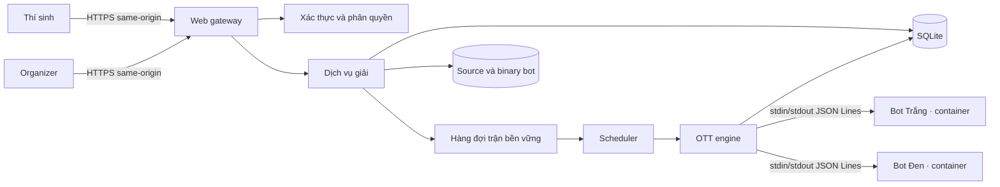

# Kiến trúc nền tảng thi đấu bot OTT

## Trạng thái

- **Hiện có:** Python judge tĩnh, CLI TCP/TLS, SQLite và Docker runner cho C++17, C17, Rust 2021 và Go. Chi tiết ở [README](../README.md) và [VibeSec](VibeSec.md).
- **Thiết kế đích:** HTTPS gateway, dịch vụ giải, OTT engine và runner bot tương tác. Chưa có thành phần OTT nào trong code.
- **Mockup:** [web tĩnh](../mockup/index.html), chạy bằng dữ liệu trong trình duyệt. Mockup không gọi API và không đại diện cho backend đã triển khai.

## Sơ đồ thành phần đích

Sơ đồ là thiết kế mục tiêu. Web gateway là reverse proxy cùng origin với web client. Trình duyệt không mở kết nối TCP/TLS trực tiếp đến CLI server.

## Trách nhiệm thành phần

| Thành phần | Trách nhiệm | Trạng thái |
|---|---|---|
| Web client | Hiển thị giải, bot, lịch, bảng điểm và trang organizer | Mockup tĩnh; chưa có sản phẩm |
| HTTPS gateway | Cookie phiên, CSRF, kiểm tra request và chuyển tiếp API | Chưa triển khai |
| Dịch vụ giải | Quyền organizer, đăng ký, phiên bản bot, khóa roster, bảng điểm | Chưa triển khai |
| Scheduler | Sinh lịch deterministic và claim trận chưa chạy | Chưa triển khai |
| OTT engine | Sinh observation, tính nước hợp lệ, áp dụng action và kết thúc ván | Chưa triển khai |
| Bot runner | Biên dịch, chạy hai process cách ly, giới hạn I/O và tài nguyên | Chưa triển khai; runner hiện tại chỉ chấm test tĩnh |
| SQLite | Lưu user, giải, suất, bot, trận và event | Chỉ bảng legacy hiện có |
| Artifact storage | Lưu source/binary ngoài vùng public; dọn sau 90 ngày | Chưa triển khai |

## Luồng chính

### Gửi và chốt bot

1. Thí sinh đăng nhập qua HTTPS; browser giữ cookie phiên `Secure`, `HttpOnly`, `SameSite`.
2. Thí sinh đăng ký tối đa một suất mỗi giải và gửi source `cpp17`, `c17`, `rust2021`, `go` hoặc `java17`, tối đa 256 KiB.
3. Dịch vụ tạo phiên bản bất biến và compile bot trong sandbox. Bản compile lỗi không thể được chọn.
4. Thí sinh chọn bản compile thành công trước khi giải chuyển sang `LOCKED`.
5. Organizer khóa roster; server đóng băng bot đã chọn và sinh lịch vòng tròn hai lượt.

### Một lượt bot

1. Scheduler claim một trận bằng lease có fencing epoch.
2. Engine nạp snapshot, clocks và history được phép thấy; tạo observation theo [bot protocol schema](bot-protocol.schema.json).
3. Runner gửi một dòng JSON qua stdin; bot trả một dòng JSON qua stdout.
4. Engine parse và tự xác thực action. Engine không tin `legal_actions` do client gửi lại.
5. Trong một transaction, engine ghi event, snapshot mới, clocks và bên tiếp theo. Event sequence duy nhất giúp phát hiện action lặp.
6. Engine kết thúc trận theo luật OTT hoặc giữ lease cho lượt tiếp theo.

## Ranh giới dữ liệu

- Database và artifact store chỉ truy cập từ backend tin cậy; browser không nhận raw event table hoặc source bot người khác.
- Organizer quản lý giải và xem compile status; chỉ chủ tài khoản xem source bot.
- Trong phase placement, engine và bot đang tới lượt được thấy placement của bot đó. API organizer và người xem không nhận vị trí placement trước reveal.
- Khi phase play bắt đầu, bot nhận observation có toàn bàn và history đầy đủ theo luật.
- Sau 90 ngày kể từ khi giải kết thúc, hệ thống xóa source, binary, state chi tiết và event log. Kết quả tổng hợp và bảng điểm được giữ.

## Hợp đồng và tài liệu liên quan

- Web API: [OpenAPI](web-api.yaml), base path `/api/v1`, HTTPS same-origin.
- Bot I/O: [JSON Schema](bot-protocol.schema.json) và [rules](rules.md).
- Vòng đời, lịch, clock, event và recovery: [match lifecycle](match-lifecycle.md).
- Bảng đích SQLite và migration: [database schema](database-schema.md).
- Threat model và kiểm soát: [VibeSec](VibeSec.md).
- Luồng màn hình: [UI/UX Draft](UI_UX_Draft.md).

